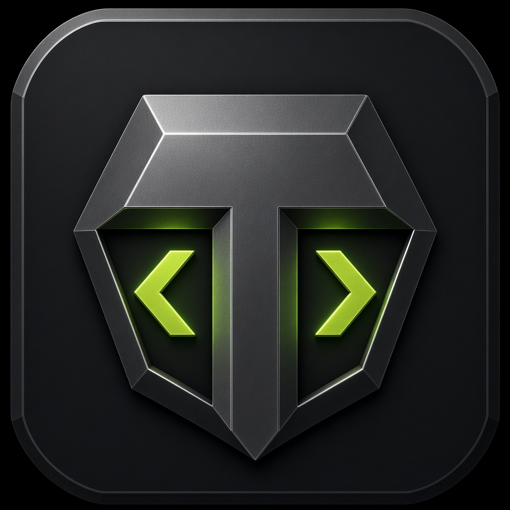

# Tungsten IDE 2.2

A rugged, installable development environment built with Electron, React, Monaco, xterm, Language Server Protocol, Debug Adapter Protocol, SSH, and Yjs. Tungsten targets Windows, macOS, and Linux while retaining a safe browser workspace for development and demonstrations.



## Tungsten 2.2 highlights

- Full merge and rebase controls with operation detection, conflict lists, three-stage conflict loading, side-by-side current/incoming review, resolution actions, continue, and abort
- Remote LSP and DAP adapter processes over the active SSH transport, plus remote project detection, tasks, structured tests, commands, and LCOV loading
- Editable, persistent keyboard shortcuts with collision handling and platform-aware labels
- Inline DAP variable values beside the stopped source line
- Managed extension lifecycle with persisted enable/disable state, user-package uninstall, scope visibility, permission display, and isolated host reactivation
- **Graphene**, Tungsten's own design language, generated from a single token file and shipped as the default appearance
- **Real editor groups**: split right or down up to four ways, each group with its own tab strip, breadcrumbs and Monaco instance, with drag-and-drop between splits
- The Tungsten 2.1 performance, multi-root, terminal, Git hunk, testing, and collaboration improvements remain included

See the [Tungsten 2.2 release notes](docs/RELEASE_2.2.md) and [2.1 performance notes](docs/RELEASE_2.1.md).

## Tungsten 2.2 workstation

### Editing and workspace engine

- Monaco editing for more than 40 languages and formats, with tabs, minimap, sticky scopes, formatting, autosave, accessible editor modes, and side-by-side preview
- Editor groups modelled on VS Code's group service: split horizontally or vertically (four groups maximum), preview and pinned tabs, close-others/close-to-the-right, move editors between groups by dragging, join all groups, and focus-follows-caret so the pane you type in becomes the active one
- Native Chokidar workspace watching with external-change indication across persisted multi-root local workspaces
- Ripgrep-backed asynchronous content search across every local root, with bounded in-process and remote fallbacks
- Bounded, lazy folder rendering; ignored dependency/build trees; 2 MB per-file and 4,000-file desktop safety limits
- Quick-open, symbol outline, command palette, dashboard, workspace profiles, settings, editable persistent keybindings, recovery snapshots, and responsive resizable panels

### Language intelligence

The generic multi-root LSP client supports completion, hover, diagnostics, go-to-definition, references, rename/workspace edits, signature help, code actions, semantic tokens, and live `workspaceFolders` updates.

- TypeScript/JavaScript language service is included
- Python, Rust, Go, C/C++, Java, C#, Ruby, PHP, Kotlin, and Lua servers are detected from `PATH`
- Syntax editing remains available if an optional external server is absent

See [Language servers](docs/LANGUAGE_SERVERS.md).

### Industrial terminals and debugging

- Persistent PTY terminal tabs and layouts, split views, buffer search, per-tab restart, dedicated task terminals, WSL profiles, Docker profiles, and interactive SSH shells
- DAP launch/configuration lifecycle with gutter breakpoints, conditional breakpoints, threads, call stacks, scopes, variables, inline stopped-line values, watches, continue, pause, step-over, step-in, and step-out
- Project launch configurations under `.tungsten/launch.json`

See [Debugging](docs/DEBUGGING.md).

### Testing and coverage

- Project test-profile detection for npm, pytest, Cargo, Go, Maven, and Gradle
- Individual test discovery for JavaScript/TypeScript, Python, Go, and Rust
- Per-test open, structured run, and debug-terminal actions with pass/fail state, duration, failure excerpts, and snapshot output
- LCOV parsing with editor gutter/overview coverage overlays
- Unit, desktop bridge-contract, production HTTP E2E smoke, and workspace benchmark commands

### Git and GitHub

- Branch/worktree status, side-by-side diffs, line-hunk and whole-file staging/unstaging, commits, checkout, and conflict visibility
- Commit graph/history, stash push/pop, blame buffers, and complete merge/rebase workflows with conflict resolution, continue, and abort
- GitHub pull-request and issue lists through the authenticated `gh` CLI

### Extension host

- Per-user and workspace package discovery
- Declarative commands, themes, languages, keybindings, and sidebar metadata
- Separate extension-host process for executable packages
- Restricted VM API, activation/command timeouts, permission review, SHA-256 entry-point verification, persisted enable/disable state, and managed uninstall

See [extension packages](docs/EXTENSIONS.md).

### Remote development and collaboration

- SFTP-backed SSH workspaces with safe file operations, indexed search, remote terminals, project/task/test detection, LCOV, and SSH-hosted LSP/DAP processes
- WSL distribution, Docker container, and Dev Container detection with dedicated terminal profiles
- Yjs shared documents over token-protected WebSocket rooms
- Visible collaborator cursors, presence, review comments, reconnection-ready room events, and voice-room signaling foundations

See [remote development and collaboration](docs/REMOTE_AND_COLLABORATION.md).

### Product and release engineering

- Welcome dashboard, settings presets, accessibility controls, reduced motion, high contrast, and screen-reader editor mode
- Telemetry disabled by default and explicit crash-report preference
- Context-isolated, sandboxed Electron renderer; narrow typed preload bridge; path/symlink protection; isolated previews
- Automatic packaged-app updates and Windows NSIS/portable, macOS DMG/ZIP, and Linux AppImage/DEB targets
- GitHub Actions cross-platform installer builds with optional signing/notarization secrets and generated release notes

## The shell dictionary

Tungsten ships a dictionary of **592 shell commands** and answers questions
about them in three places: the **Shell Dictionary** view in the activity bar,
the terminal prompt, and the command palette.

```bash
man tar                 # the full page: synopsis, flags, examples, see also
apropos compress        # search every summary, flag table and example
whatis jq               # the one-line description
explain sudo rm -rf /var/cache    # read a whole command line back in English
```

`explain` is the reason the dictionary exists. It splits a line on the operators
that change its meaning — respecting quotes, so a pipe inside a string stays a
pipe character — resolves each command against the dictionary, expands bundled
short flags (`-la`) and dashless clusters (`tar czf`), follows wrappers through
to what they will actually run (`xargs -0 rm -f` warns about the `rm`), and
names every redirection. Anything it does not recognise is reported rather than
guessed at.

The terminal is dictionary-aware throughout: a hint under the prompt explains
what you are typing as you type it, a command the browser sandbox cannot run is
answered with what the dictionary knows about it instead of a dead end, and a
typo is met with the nearest match — the distance metric counts a swapped pair
of letters as one mistake, so `gti` finds `git`.

A workspace can document its own commands. Drop JSON into `dictionary/`:

```
dictionary/team.commands.json   →   { "commands": [ { "name": "deploy", ... } ] }
```

Those entries are read as data — nothing in the file is ever evaluated — and
merged into the same index, so the sidebar, `man`, `apropos` and `explain` all
answer for them. A workspace entry may also override a built-in one. The
palette command **Shell Dictionary: Document a Command for This Workspace**
writes a worked example to start from.

`src/shell/` holds it: `commandModel.ts` (the shape of an entry), `data/` (the
entries, by subject), `commandDictionary.ts` (the index, search, suggestions and
the manual renderer), `explainShell.ts` (the command-line reader) and
`workspaceCommands.ts` (the loader). `src/shell/commandDictionary.test.ts`
treats the data as something to be verified, not trusted: no duplicate names, no
cross-reference to a page that does not exist, no entry pointing at itself,
every synopsis actually invoking the command it documents.

## A real terminal in the browser

The desktop build spawns a PTY in the Electron main process. The browser build
now gets the same thing: `server/shellPlugin.ts` is a Vite plugin that hosts
real `node-pty` processes behind a WebSocket at `/__tungsten/pty`, and
`src/terminal/ptyClient.ts` presents that socket to the workbench through the
identical API the Electron bridge exposes. `DesktopTerminal` — xterm, fit,
search, scrollback — does not know which one it is driving.

So the terminal in a browser tab is bash. Not an emulation of bash: the shell
on the machine, with job control, colour, a working `cd`, your environment,
`git`, `node`, `python3`, `vim`, `top`, and every other binary on `PATH`.

| Host | Used when | What runs |
| --- | --- | --- |
| Electron PTY | the desktop app | `node-pty` in the main process |
| Socket PTY | `npm run dev` / `npm run preview` | `node-pty` in the Vite server |
| Emulated shell | a static production build | `src/terminal/sandboxShell.ts` |

The workbench probes `/__tungsten/shell/health` once at startup and picks the
best host available, so the same bundle degrades to the emulated shell when
there is nothing to attach to.

Each shell starts from a generated rc file that sources your own config first
and then adds Tungsten's dictionary, so `man`, `whatis`, `apropos` and
`explain` work inside the real shell — on a container with no man pages
installed, `man rsync` still answers.

### What keeps this safe

Handing a browser tab a shell is not a small thing, so:

- the plugin is `apply: 'serve'` — it exists during `vite dev` and
  `vite preview` and is **never** part of a production bundle; the built
  `dist/` contains no server, no `ws` and no `node-pty`
- sockets whose `Origin` is not the page being served are refused, so another
  site open in the same browser cannot reach your shell
- `TUNGSTEN_SHELL=off` disables it, and the startup banner always says which
  shell you got
- input is capped, terminal dimensions are clamped, at most twelve shells may
  be open at once, and closing a tab kills its process

`server/shellPlugin.test.ts` boots a real server and drives it the way the
browser does: probe, connect, start bash, run `echo`, check that `cd /tmp`
persists into the next command, read a manual page through the shell function,
and confirm a foreign origin is turned away.

## The boot screen

`index.html` carries the boot screen inline — markup and CSS both — so it
paints on the first frame, before the bundle, the stylesheet or React exist.
A lime hexagonal lattice draws itself, two rings counter-rotate, an arc
strikes across it and a sheen crosses the metal; the wordmark rises a letter
at a time.

The checklist beneath it is not decoration. Each line is ticked when the
thing it names has actually loaded — the workbench chunk, the language
grammars, the shell dictionary, the block library, the workspace — because a
bar that animates on a timer while the app is still fetching is a lie told
with a spinner. `src/boot/splash.ts` holds the rules: a minimum time on
screen so a fast start does not flash something illegible, a shorter one
when the machine asks for reduced motion, and a failsafe that takes the
screen away regardless if start-up never reports finishing.

## The application icon

`resources/icon.png` is what every packager reads. Artwork can arrive in any
format: drop it in `resources/` as `icon.jpg`, `icon.jpeg`, `icon.webp` or
`icon.source.png` and run

```bash
npm run icon            # convert the newest source to resources/icon.png
npm run icon -- --check # fail if icon.png is stale
```

The source file is kept, never deleted, and `resources/icon.lock.json`
records the SHA-256 it was built from — modification times are meaningless
after a clone, so `--check` compares hashes and gives the same answer on
every machine. `resources/icon.svg` is the vector master and is deliberately
not used as a conversion source: rasterising SVG needs a delegate ImageMagick
often lacks, and failing at packaging time over a missing library is not a
good surprise.

The boot screen draws the same shield, T and chevrons as line work, so what
you see while Tungsten starts is recognisably the icon in your dock.

## Graphene, the design language

`src/theme/tokens.json` is the single source of truth for how Tungsten looks: the
neutral ramp, the one lime accent, the signal hues, the syntax palette, the type
scale and the geometry. Nothing else hard-codes a colour.

```bash
npm run graphene            # regenerate the theme and the stylesheet variables
npm run graphene -- --check # fail if either output is stale (runs inside `npm run check`)
```

Two artefacts are derived from it and must never be hand-edited:

- `src/theme/graphene.generated.ts` — a `TungstenTheme` the runtime service applies
  to the workbench, Monaco and xterm in one pass.
- the `:root` token block in `src/styles.css` — the first-paint fallbacks, which
  have to equal the runtime values or the window flashes on launch.

The ten imported VS Code themes remain available in the picker; Graphene is simply
the one the product ships as. Tests in `src/theme/graphene.test.ts` enforce the
invariants that make it a design system rather than a palette: WCAG contrast floors
computed with the app's own implementation, a monotonic neutral ramp, a single
accent across every primary affordance, and the absence of any stock VS Code blue.

## Run the desktop app

```bash
npm install
npm run desktop:dev
```

A graphical desktop session is required. External tools such as Git, ripgrep, `gh`, Docker, language servers, and debug adapters are detected and integrated when installed; Tungsten does not silently bundle those ecosystems.

## Browser development

```bash
npm run dev
```

The Vite server binds to `0.0.0.0`. Browser mode includes the editor and simulated local workspace. Native filesystem, PTY, Git, LSP/DAP processes, SSH, executable extensions, collaboration hosting, and updates remain behind Electron's preload boundary.

## Run it on the web

Tungsten ships twice from one source tree. The desktop build is an Electron
app; the web build is a folder of static files you can put on any host.

```bash
npm run domain -- yourdomain.com   # once, after you buy the domain
npm run web:build                  # dist/ is now a deployable site
npm run web:serve                  # build it and serve it locally
```

The domain lives in `site.json`, along with the title, description and theme
colour. It is the only file to edit, and everything derived from it — the
install manifest, the social card, the canonical link, the sitemap, the
`CNAME` — is generated by tested functions in `src/web/site.ts`. The build
works with no domain set at all: every path it emits is relative, so the same
`dist/` runs from a subdirectory, a preview URL or a file:// folder. Setting
the domain only adds the things that genuinely need an absolute address.

`npm run web:build` runs the normal production build and then writes into
`dist/`:

| File | What it is for |
| --- | --- |
| `manifest.webmanifest` | Installing Tungsten as an app, with shortcuts to a new file, the builder and the terminal |
| `sw.js` | Offline support and the update prompt (below) |
| `404.html` | A redirect to the root, not a copy of the app — with relative asset paths, a copied page breaks at any depth |
| `robots.txt`, `sitemap.xml` | Crawlers. The sitemap is only written when a domain is set, because a sitemap of relative URLs is invalid |
| `_headers`, `_redirects` | Netlify-style host configuration: hashed assets immutable for a year, the page and the worker never cached |
| `CNAME` | GitHub Pages reads this to attach your domain and issue the certificate |

Install icons are **committed**, in `public/icons/`, and regenerated with
`npm run web:icons` when the artwork changes. That keeps image tooling off
the deploy path; CI only runs `npm run web:icons -- --check`, which compares
a hash of `resources/icon.png` against `resources/web-icons.lock.json`.

### Offline, and updating

The service worker precaches the shell — the page, the stylesheets, the
fonts, the entry chunk and React — which is about 780 kB. It deliberately
does *not* precache the rest: the Monaco core and the TypeScript language
worker are 11 MB between them, and downloading those before the first paint
would make a first visit feel broken. They are stored the first time they are
actually used, after which Tungsten runs with no network at all.

Three strategies, in `src/web/serviceWorker.ts`:

- **navigations** — network first, cached shell as the fallback, so a deploy
  is picked up immediately but a tunnel still gets the app;
- **hashed assets** — cache first, because the filename contains a hash of
  the contents and a hit can never be stale;
- **everything else** — network only.

A new deploy does not reload the page underneath you. The worker installs in
the background and the status bar's update slot — the same one the desktop
updater uses — changes to **Reload to update**. Clicking it tells the waiting
worker to take over and reloads once it has. The same slot reads **Offline**
when the browser loses the network, with a tooltip explaining that your work
is still saved locally.

None of this runs in development or in the desktop app: a cached shell served
over the dev server would quietly hand you a stale build.

### Deploying

`.github/workflows/deploy-web.yml` runs the full `npm run check` gate, builds
the site and publishes it to GitHub Pages on every push to the working
branch. Point your domain at it with a `CNAME` record for a subdomain, or `A`
records to GitHub's four Pages addresses for an apex domain, then enable
Pages for the repository with the source set to **GitHub Actions**.

Any other static host works, because the output is only a folder:

```bash
npx netlify deploy --prod --dir dist      # Netlify reads _headers and _redirects
npx vercel deploy --prebuilt dist         # Vercel
rsync -av --delete dist/ server:/var/www/tungsten/   # nginx, Caddy, anything
```

For a hand-rolled server the only rules that matter are the ones in
`_headers`: serve `index.html` for unknown paths, never cache `index.html` or
`sw.js`, and cache `/assets/*` forever.

## Build installers

```bash
npm run desktop:dist
```

Installers are written to `out/`. Build on each target OS or use the included `Build desktop installers` GitHub Actions workflow. Optional signing environment variables are documented in the workflow. Create an unpacked current-platform app with `npm run desktop:pack`. See the [laptop testing guide](docs/LAPTOP_TESTING.md) for installation notes and the acceptance checklist.

## Workbench structure

`src/App.tsx` owns workbench state — the workspace, the editor group layout, debug and terminal sessions — and nothing else. Everything it renders lives in its own component and receives data and callbacks as props:

| Area | Components |
| --- | --- |
| Editor | `components/EditorGroup.tsx`, `components/ConfiguredEditor.tsx`, `components/Preview.tsx` |
| Sidebar | `components/sidebar/` — `ExplorerView`, `SearchView`, `SourceControlView`, `DebugView`, `TestingView`, `ExtensionsView`, `DictionaryView` |
| Panel | `components/panel/` — `ProblemsPanel`, `TerminalPanel`, `DesktopTerminal` (xterm over a PTY) |
| Chrome | `components/TitleBar.tsx`, `components/StatusBar.tsx`, `components/ActivityBar.tsx`, `components/panel/PanelHeader.tsx`, `components/ContextMenu.tsx` |
| Dialogs | `components/dialogs/` — command palette, theme picker, settings, settings editor, snippets, keyboard shortcuts, collaboration, remote, new project, new file |
| Shared | `components/Modal.tsx`, `components/FileGlyph.tsx`, `components/TipButton.tsx`, `components/Highlight.tsx` |

The same pattern holds for every other long-running concern: `src/search/` (the query, its options, the desktop's ripgrep pass and replace-all), `src/collaboration/` (a room's people, their cursors and the comment thread, folded in by pure rules), `src/project/` (tasks, tests, coverage and installed extensions, re-read whenever the workspace changes), `src/remote/` (SSH, WSL and container connections), `src/languages/` (the Monaco providers, and the diagnostics each server publishes, merged per file), `src/workbench/` (which view is showing, and how big the side bar and panel are) and `src/configuration/` (every preference, as the one store both settings dialogs edit) are services too.

The same pattern holds for the other long-running concerns. `src/debug/` runs the debug session: `debugModel.ts` is the Debug Adapter Protocol as a pure reducer — a message and the current session in, the next session and the requests it implies out — and `useDebugSession.ts` adds the adapter process, breakpoint path resolution and the watch expressions. `src/terminal/` owns the panel's sessions: `terminalSessions.ts` holds the tab-strip rules and the layout that survives a reload, `sandboxShell.ts` is the browser build's emulated shell, and `useTerminalSessions.ts` decides between a real child process and that shell.

Git is a service rather than a pile of state: `src/git/useGitService.ts` owns status, history, branches, stashes, staging, commits, diffs, blame and conflict resolution, and is the only caller of the Git bridge. Its state is stamped with the workspace root it describes, so opening another folder shows empty Git state at once and a late reply for the old root is discarded. The pure parts — status codes, the merge of Git's view with unsaved buffers, and the naming of the `.tungsten/` diff, conflict and blame documents — live in `src/git/gitModel.ts`. The browser build's emulated shell is likewise pure: `src/terminal/sandboxShell.ts` turns a command and a workspace snapshot into output lines.

Every dialog is built on one `Modal` shell, so backdrop dismissal, Escape, the dialog role and an accessible name are implemented once and none can be missing. The title bar renders a menu model the workbench resolves from the command table, so a menu entry cannot disagree with the command it invokes.

None of these components reads `localStorage` or calls `window.tungsten`: desktop capability arrives as a prop, so every view renders in the browser build and in jsdom. `src/components/views.test.tsx` and `src/components/dialogs.test.tsx` mount each one and drive it, and `src/platform.test.ts` enforces the boundary.

## The visual builder

Open it from the activity bar. Drag a block out of the library onto the canvas,
drag a wire from one pin to another — or push two blocks together until they
snap onto the same execution chain — and the code writes itself in the pane
beside the canvas. Start from a recipe when the shape is a familiar one: a
sign-in form, an OAuth button, a list drawn from a table, an API call, all
wired in a click. Drag a wire into empty space and the quick-add menu offers
only the blocks that fit it, then creates and connects one in the same
gesture. Ctrl+Z undoes a whole gesture, Ctrl+D duplicates, the arrows nudge. Drag a
marquee to select many blocks and move, copy or delete them together;
Ctrl+C and Ctrl+V carry a selection between windows and workspaces; one
button tidies the whole graph into columns.

An app is more than one screen, so the strip above the canvas is a screen
bar: add one, rename it in place, choose which screen the app starts on, and
send the selection to another. Each screen has its own canvas and its own
handlers, the Go To Screen / Go Back / Current Screen blocks move between
them, and the preview navigates for real. A one-screen project writes exactly
the file it always did; the screen declaration appears only once a second
screen does.

The program is not trapped in the builder: it is `src/generated/blocks.ts`, a
real file in the workspace. Open it in any editor tab and what you type moves
the blocks; move the blocks and the tab updates under you. The toolbar says
which file it is bound to, and the binding can be switched off. Edit that code by hand and the blocks follow, 300ms after
you stop typing; break the syntax and the canvas goes read-only with a banner
instead of guessing. An integrity checker refuses to compile a graph with a
type mismatch, a cycle or an unreachable read, and every diagnostic names the
fix. See **[docs/BLUEPRINT.md](docs/BLUEPRINT.md)**.

## One canvas, six applications

A project is not a platform. The graph on the canvas is a program, and the
platforms it can be carried to are a list you choose:

```
[ Organization ]
        └── [ Project ]
                ├── Android App Target (Flutter)   or Kotlin, Jetpack Compose
                ├── iOS App Target (Flutter)       or Swift, SwiftUI
                ├── Cross-Platform Mobile Target (Flutter)
                ├── Windows Desktop Target (Tauri) or Electron
                ├── macOS Desktop Target (Tauri)   or Electron
                └── Linux Desktop Target (Tauri)   or Electron
```

The **Targets** tab at the bottom of the builder is where this lives. Tick a
platform to add it, press Build on its row to write its source tree, or run
**Builder: Build Every Target in the Project** from the command palette to
write all of them at once. Each target gets its own directory —
`targets/<project>/android`, `targets/<project>/ios`, and so on — so no two
builds can overwrite each other.

### The toolchain is a second choice

A target says where the app runs. A **toolchain** says what it is made of,
and the two are not the same decision, so the Targets tab asks both. Each
row has a dropdown next to it wherever there is a real choice:

| Target | Default | The alternative |
| --- | --- | --- |
| Android | Flutter | Kotlin and Jetpack Compose |
| iOS | Flutter | Swift and SwiftUI |
| Cross-Platform Mobile | Flutter | — it is Flutter by definition |
| Windows, macOS, Linux | Tauri | Electron |
| Web | the DOM | — |

Flutter leads on the phones because one source tree covering both is less
to keep in step than two. Tauri leads on the desktop because a Rust shell
around the system webview ships a fraction of the bytes Electron does —
`src-tauri/` with a `Cargo.toml`, a `tauri.conf.json` and a `main.rs` that
registers no commands, so the generated page has no more privilege than a
web page. Neither default deletes the other option: Kotlin, Swift and
Electron are each one dropdown away, from the same graph, and both halves
of every choice are covered by tests.

The choice is stored per project and only when it differs from the default,
so changing a default later does not leave every saved workspace
disagreeing with it. The output directory does not change with the
toolchain — `targets/<project>/android` is the Android tree whatever wrote
it — so each generated README names the toolchain that produced the folder
and tells you to delete it before switching.

### The backend Tungsten writes for you

**Builder: Build the Backend Service**, or the Build button beside
*Backend Service* in the Targets tab, writes `targets/<project>/server`:

```
server/main.js       one Node service, zero dependencies
server/schema.sql    the tables you drew, plus users, sessions, files
server/package.json  "start": "node main.js"
```

`node main.js` and it is up on `http://localhost:8787`. It needs Node 22.5
or newer, because `node:sqlite` is built in from there, and nothing else at
all — no install step, no package to be yanked out from under it.

| Route | What it does |
| --- | --- |
| `/auth/sign-up`, `/auth/sign-in` | accounts, scrypt-hashed, returns a session token |
| `/auth/session`, `/auth/sign-out` | who the bearer token is, and forgetting it |
| `/auth/oauth` + `/auth/callback/:provider` | GitHub and Google, when you set the client id and secret |
| `/data/<table>` | GET, POST, PATCH, DELETE for every table in the schema editor |
| `/storage/<bucket>` | files in, files out |

The palette matches it. **Sign Up with Email**, **Sign In with Email**,
**Sign Out**, **Sign In with Provider**, **Current Session**, **Query
Table**, **Insert Row**, **Update Row**, **Delete Row** and **Upload File**
each compile to one of those routes, in every language — a block that
worked on the web and turned into a comment on Android would be a trap
rather than a feature.

The tables are the boxes you drew in the **Data** tab. Nothing outside that
schema reaches SQL: table and column names are looked up in a generated
map and every value is a bound parameter, so a field that is not a column
is dropped rather than interpolated. Uploads are stored under a generated
name, never the one the caller sent.

It is written to be read before it is run. The README it ships with has a
*Before it leaves your machine* section: `TUNGSTEN_REQUIRE_AUTH=1` to make
writes need a signed-in user, `TUNGSTEN_ORIGIN` instead of the `*` it
answers with on your laptop, and TLS in front of it.

The organization exists for one practical reason: every mobile and desktop
platform identifies an application by a reverse-DNS string, and the only
honest source for the first half of that string is who you are. An
organization called Acme and a project called Timer give `com.acme.timer`,
which reaches the Android `applicationId`, the iOS
`PRODUCT_BUNDLE_IDENTIFIER` and the desktop `appId` without being typed
three times. Type your own identifier and a later rename will not overwrite
it. A Linux package name is the slug, `timer`, because `com.acme.timer` as a
.deb name is wrong.

### The component library

Eleven blocks in the UI category: Heading, Text, Button, Text Input,
Input Value, Checkbox, Dropdown, Image, Link, Divider and Stack. Each one
renders on all six targets in that platform's own idiom — a Heading is an
`<h2>` on the web, `headlineMedium` in Compose, `.title` in SwiftUI and a
weighted `TextStyle` in Flutter, because a level is semantic and faking one
with a font size throws away the outline and the screen reader with it.

Checkboxes and dropdowns are read with the same Input Value block that
reads a text field: a box answers `"true"` or `"false"`, a dropdown answers
the chosen string. One way to read what the user did, whatever the control
looks like.

A Stack is a row or a column, and whatever is wired into its body is drawn
inside it — on the phone targets too, which until recently flattened
containers into an empty label.

### What is actually generated

Everything is lowered once into an IR — events, statements, components,
screens, tables — and each target is a function over that IR. The phone
targets produce **native source, not a web view**: Compose composables and
SwiftUI views, with your handlers as `suspend fun` and `async func`. The
three desktop targets share one emitter and render with the web output,
which is a deliberate difference rather than a shortcut — a window is a
window, and Tungsten itself ships exactly this way.

Backend calls (`select`, `insert`, `request`, `signUp`, `upload`) used to be
stubs that printed what they would have done. They are now real: each
target ships a `Runtime` file that speaks HTTP to the generated backend —
`HttpURLConnection` and `org.json` on Android, `URLSession` on iOS,
`dart:io` in Flutter, `fetch` on the web and the desktop. All five agree on
the same routes and send the session as a bearer token, and the Android and
Flutter runtimes know that an emulator reaches your machine at `10.0.2.2`
rather than localhost.

The in-IDE preview starts simulated — a preview that wrote to your
database the first time you opened a canvas would be a preview that could
ruin your afternoon. Underneath it is a switch:

> ☐ Simulated backend &nbsp; `http://localhost:8787`

Build the Backend Service, run `node main.js`, flick the switch, and the
same blocks stop narrating and start making requests: `GET /data/notes`,
`PATCH /data/notes/7`, a bearer token carried from the sign-in onward,
and the service's own error sentence in the console when something is
wrong. The address is checked before it is used — http or https, no
credentials, no query — because it ends up inside the sandbox document.

One related fix: a field box holding `{ title: "Hello", done: false }` is
now sent as an object everywhere. It becomes `mapOf("title" to "Hello", …)`
in Kotlin, `["title": "Hello", …]` in Swift, a `<String, dynamic>` map in
Dart and a plain object literal on the web, instead of one long string
that arrived at the backend with no columns the schema recognised.
Anything that is not a flat object literal is left alone as text.

Each tree comes with a README saying exactly which commands turn it into an
artifact and which machine can run them.

## Extending Tungsten

Four extension points, all read from the workspace you have open:

| I want to… | Put a file here | Runs code? |
| --- | --- | --- |
| Add a block to the visual builder | `plugins/*.block.json` | no — it is a template |
| Add a block that needs real logic | `src/builder/blockLibrary.ts` via `defineBlock` | yes, it is app source |
| Document a shell command | `dictionary/*.commands.json` | no — it is data |
| Add IDE commands, languages, themes | `extensions/<id>/extension.json` | only if you opt in |

Full worked examples, the field reference and the failure messages are in
**[docs/PLUGINS.md](docs/PLUGINS.md)**. The visual builder's specification and
where each part of it is implemented is in **[docs/BLUEPRINT.md](docs/BLUEPRINT.md)**.

## Validation

```bash
npm run check
npm run test:e2e
npm run bench:workspace
npm audit
```

`check` verifies the Graphene outputs are current, then runs ESLint, Vitest, TypeScript, and the production Vite build. The E2E smoke boots the production server and validates its shell and application bundle. The benchmark reports indexed files, bytes, throughput, elapsed time, and heap use. Add `npm run web:icons -- --check` before a deployment to confirm the committed install icons still match the source artwork.
